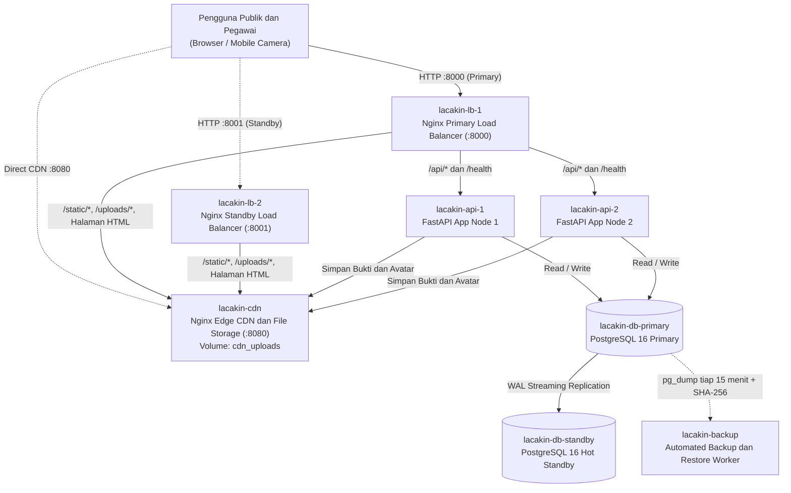

# LacakIn — Cloud-Native Logistics Tracking, High Availability, Disaster Recovery, and Edge CDN


**LacakIn** (`logistik-dr`) adalah sistem pelacakan pengiriman dan manajemen rantai pasok *real-time* yang dirancang dengan arsitektur **High Availability (HA)**, **Disaster Recovery (DR)** berstandar **Aturan Backup 3-2-1**, **Role-Based Access Control (RBAC)** 5 tingkat jabatan, serta **Edge CDN dan File Storage Mandiri** berbasis Docker.

---

## Daftar Isi
1. [Fitur Utama](#-fitur-utama)
2. [Arsitektur Sistem (8 Container HA + DR + CDN)](#-arsitektur-sistem-8-container-ha--dr--cdn)
3. [Matriks Hak Akses (RBAC) dan Akun Default](#-matriks-hak-akses-rbac-dan-akun-default)
4. [Cara Menjalankan Proyek (Quickstart)](#-cara-menjalankan-proyek-quickstart)
5. [Pengujian Beban (k6 Stress Test) dan Disaster Recovery](#-pengujian-beban-k6-stress-test-dan-disaster-recovery)
6. [Struktur Direktori](#-struktur-direktori)
7. [Dokumentasi Lengkap Pertemuan 1 sampai 5](#-dokumentasi-lengkap-pertemuan-1-sampai-5)

---

## Fitur Utama

- **Pelacakan Resi Real-Time dan Scan Kamera:** Pelanggan publik dan petugas dapat melacak posisi paket melalui input kode atau **Scan Barcode / QR Resi menggunakan kamera langsung** (`getUserMedia`).
- **Wajib Bukti Foto Pengiriman (File atau Kamera):** Setiap pencatatan checkpoint wajib melampirkan foto bukti pengiriman (bisa unggah file atau jepret langsung dari kamera perangkat) yang disajikan melalui container mandiri `lacakin-cdn`.
- **Daftar Paket Tugas Kurir Aktif:** Kurir memiliki panel khusus untuk melihat paket aktif yang ditugaskan dan memilihnya dalam 1 klik.
- **Generator Laporan Operasional (Harian, Mingguan, Bulanan):** Operator, Supervisor, Admin, dan Superadmin dapat mengunduh laporan ke format **Microsoft Excel (`.xls`)** atau **Cetak PDF** (otomatis disembunyikan dari Kurir).
- **Manajemen Profil dan Foto Akun Mandiri (`/profil`):** Seluruh peran pegawai dapat melihat identitas lengkap, mengganti foto profil (unggah file, kamera langsung, atau hapus), memperbarui data kontak/penempatan, dan mengganti kata sandi sendiri.
- **Deteksi Spesifik Autentikasi Login:** Sistem memvalidasi dan menandai secara spesifik apakah **NIP/NIK/Username tidak ditemukan**, **Kata Sandi salah**, atau **keduanya salah**.
- **High Availability dan Disaster Recovery:** Replikasi *streaming* WAL PostgreSQL (`db-primary` ke `db-standby`), *auto-failover* Nginx Load Balancer (`lb-1`, `lb-2`) ke 2 node API (`api-1`, `api-2`), dan *automated backup* setiap 15 menit (`lacakin-backup`) dengan verifikasi `pg_restore --list` serta checksum `SHA-256`.

---

## Arsitektur Sistem (8 Container HA + DR + CDN)



| Nama Container | Service | Image | Port Host | Peran dan Hardening |
| :--- | :--- | :--- | :--- | :--- |
| `lacakin-lb-1` | `lb-1` | `nginx:1.27-alpine` | `:8000 -> :80` | Primary Reverse Proxy dan Load Balancer (`0.50 CPU`, `128 MB`) |
| `lacakin-lb-2` | `lb-2` | `nginx:1.27-alpine` | `:8001 -> :80` | Standby Load Balancer untuk failover gateway (`0.50 CPU`, `128 MB`) |
| `lacakin-cdn` | `cdn` | `nginx:1.27-alpine` | `:8080 -> :80` | Edge CDN untuk aset statis UI dan File Storage bukti resi (`0.75 CPU`, `256 MB`) |
| `lacakin-api-1` | `api-1` | `logistik-dr-api-1` | Internal `:8000` | Node utama FastAPI stateless, `SERVE_STATIC=0`, non-root `appuser` (`0.75 CPU`, `384 MB`) |
| `lacakin-api-2` | `api-2` | `logistik-dr-api-2` | Internal `:8000` | Node replika FastAPI untuk HA dan autoscaling (`0.75 CPU`, `384 MB`) |
| `lacakin-db-primary` | `db-primary` | `postgres:16-alpine` | Internal `:5432` | Database utama transaksi tulis/baca (`1.00 CPU`, `512 MB`) |
| `lacakin-db-standby` | `db-standby` | `postgres:16-alpine` | Internal `:5432` | Hot standby penerima replikasi WAL streaming (`1.00 CPU`, `512 MB`) |
| `lacakin-backup` | `backup` | `logistik-dr-backup` | Internal | Worker `pg_dump` berkala 15 menit + verifikasi `pg_restore` + `restore.sh` (`0.50 CPU`, `256 MB`) |

---

## Matriks Hak Akses (RBAC) dan Akun Default

| Jabatan (Role) | NIP Default | Username | Kata Sandi | Hak Akses Utama |
| :--- | :--- | :--- | :--- | :--- |
| **Superadmin** | `SUP-0001` | `superadmin` | `super123` | Akses penuh seluruh sistem, toggle fitur (`/backup`), manajemen pegawai (`/pegawai`), hapus paket/bukti, cetak laporan, dan profil |
| **Admin** | `ADM-0001` | `admin` | `admin123` | Manajemen pegawai operasional, hapus paket dan lampiran bukti, catat checkpoint, cetak laporan Excel/PDF, dan profil |
| **Supervisor** | `SPV-0001` | `supervisor` | `spv123` | Monitoring daftar pengiriman dan pelacakan (*read-only*), cetak laporan Harian/Mingguan/Bulanan (Excel/PDF), dan profil |
| **Operator Gudang** | `OPR-0001` | `operator` | `op123` | Registrasi pengiriman baru, update seluruh status checkpoint + wajib foto bukti, cetak laporan Excel/PDF, dan profil |
| **Kurir Lapangan** | `KUR-0001` | `kurir` | `kurir123` | Melihat daftar paket tugas aktif, scan resi kamera, update status pengantaran lapangan + wajib foto bukti, dan profil sendiri |

---

## Cara Menjalankan Proyek (Quickstart)

### 1. Menyalakan Seluruh Stack (8 Container)
```powershell
docker compose up -d --build
docker compose ps
```

### 2. Membuka Halaman Aplikasi
- **Dashboard Ringkasan:** http://localhost:8000
- **Catat Checkpoint (Scan Resi dan Kamera Bukti):** http://localhost:8000/checkpoint
- **Daftar Pengiriman dan Ekspor Laporan:** http://localhost:8000/pengiriman
- **Lacak Resi Publik:** http://localhost:8000/lacak
- **Profil dan Pengaturan Akun:** http://localhost:8000/profil
- **Manajemen Pegawai:** http://localhost:8000/pegawai
- **Panel Backup dan Sistem:** http://localhost:8000/backup
- **Login Pegawai:** http://localhost:8000/login

---

## Pengujian Beban (k6 Stress Test) dan Disaster Recovery

### 1. Stress Test API dan Autoscaling (Pertemuan 3)
```powershell
# Uji cepat (smoke)
.\loadtest\run-test.ps1 -Name smoke -Hold 10s -Ramp 5s

# Uji dengan autoscaler aktif (live dashboard di http://localhost:5665)
.\loadtest\autoscaler.ps1
.\loadtest\run-test.ps1 -Name autoscale
```
- **Hasil Autoscale (`1 -> 2` Node):** `49.137` request (`84,35 req/s`, naik **+21,9%** dibanding 1 node), tingkat keberhasilan **99,99%** (`0,00%` error rate).

### 2. Simulasi Disaster Recovery dan Restore Otomatis (Pertemuan 4)
```powershell
.\backup\dr-test.ps1
```
- **Failover Node API (`D1`):** RTO aktual **3,02 detik**, RPO **0 detik**.
- **Pemulihan *Human Error* Hapus Data Massal via `restore.sh` (`D4`):** RTO aktual **0,99 detik**, data kembali utuh 100% di primary dan standby.
- **Pemulihan Outage Database Primary (`D2`):** RTO aktual **5,14 detik**, replikasi WAL otomatis kembali `streaming`.

### 3. Benchmark Edge CDN vs Tanpa CDN (Pertemuan 5)
```powershell
.\loadtest\run-test.ps1 -Name cdn-after -Script cdn-stress.js -Hold 10s -Ramp 5s
```
- **Lonjakan Throughput:** Dari `251,98 req/s` (`16.498` request) sebelum CDN menjadi **`939,82 req/s`** (`61.235` request, **naik +273% / 3,73x lipat**) sesudah menggunakan `lacakin-cdn`.
- **Penurunan Latency:** Median waktu respons turun **-85,0%** (dari `1.290 ms` menjadi **`194,03 ms`**).

---

## Struktur Direktori

```text
logistik-dr/
├── api/
│   ├── Dockerfile            # Image FastAPI non-root (appuser)
│   ├── main.py               # Endpoint REST API, RBAC, Auth, Upload CDN, dan Profil
│   ├── requirements.txt      # Dependensi Python (FastAPI, Uvicorn, Psycopg)
│   └── static/               # Aset Frontend (HTML, CSS, JS, SVG) yang disajikan via CDN
├── backup/
│   ├── Dockerfile            # Image worker backup PostgreSQL 16
│   ├── backup.sh             # Otomatisasi pg_dump 15 menit + SHA-256 + retensi 24 jam
│   ├── restore.sh            # Skrip verifikasi checksum dan pg_restore otomatis
│   └── dr-test.ps1           # Orkestrator pengujian skenario bencana D1, D4, dan D2
├── db/
│   ├── init.sql              # Skema tabel shipments, tracking_events, users, system_settings
│   ├── init-primary.sh       # Konfigurasi user replikator dan pg_hba.conf
│   └── standby-entrypoint.sh # Inisialisasi pg_basebackup untuk hot standby
├── loadtest/
│   ├── stress.js             # Skrip k6 uji beban API (10 -> 100 -> 500 -> 1000 VU)
│   ├── cdn-stress.js         # Skrip k6 uji beban aset statis CDN
│   ├── autoscaler.ps1        # Autoscaler berbasis metrik CPU container
│   ├── run-test.ps1          # Runner k6 Docker dengan dashboard live :5665
│   └── results/              # Laporan HTML, JSON summary, dan CSV hasil pengujian
├── nginx/
│   ├── nginx.conf            # Konfigurasi Load Balancer (lb-1 dan lb-2)
│   └── cdn.conf              # Konfigurasi Edge CDN dan File Storage (lacakin-cdn)
├── docs/                     # Dokumentasi lengkap Laporan Pertemuan 1 s/d 5
└── docker-compose.yml        # Orkestrasi final 8 container HA + DR + CDN
```

---

## Dokumentasi Lengkap Pertemuan 1 sampai 5

- [Laporan Pertemuan 1 — Arsitektur Sistem dan Disaster Recovery Plan (DRP)](docs/PERTEMUAN-1-ARSITEKTUR-DAN-DRP.md)
- [Laporan Pertemuan 2 — Containerization, Replikasi Database, dan Security Hardening](docs/PERTEMUAN-2-CONTAINER-DAN-HARDENING.md)
- [Laporan Pertemuan 3 — Stress Testing k6, Autoscaling, dan Analisis Bottleneck](docs/PERTEMUAN-3-STRESS-TEST.md)
- [Laporan Pertemuan 4 — Eksekusi Disaster Recovery Test dan Validasi RTO/RPO](docs/PERTEMUAN-4-DR-TESTING.md)
- [Laporan Pertemuan 5 — File Management, Edge CDN, dan Benchmark Performa](docs/PERTEMUAN-5-CDN-DAN-STORAGE.md)
