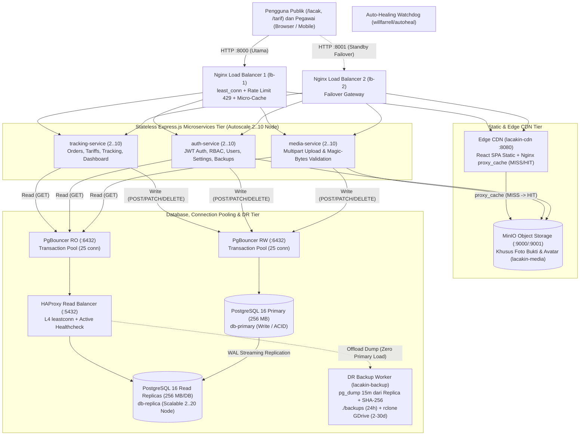

# LacakIn (`logistik-dr`) — Sistem Logistik dan Pelacakan Paket High Availability

> **Tugas Terstruktur Cloud Computing — Kelompok 6**  
> **Dosen Pengampu:** Dr. Moch Yasin, S.Kom., M.Kom., M.B.A., MTCNA., CDCP  
> **Studi Kasus:** Dashboard Logistik dan Rantai Pasok (*Supply Chain*) Wilayah Jawa Timur (38 Kabupaten/Kota, 32 Hub)

**LacakIn v2** adalah aplikasi manajemen pesanan, kalkulator tarif, pelacakan resi *real-time*, dan pencatatan checkpoint pengiriman berbasis arsitektur **Microservices**, **High Availability (HA)**, **Full-Stack Horizontal Auto-Scaling**, **Real Edge CDN Proxy Cache**, dan **Disaster Recovery (DR)** di atas Docker.

---

## 1. Tim Pengembang (Kelompok 6)

| Nama | NIM | Peran Utama |
| :--- | :--- | :--- |
| **Ammar Arifin** | 09040624081 | Lead Architect, Backend Microservices Express.js, dan Koordinator DRP |
| **Azzam Wildan Shidqii Al-afghani** | 09040623054 | Database Architect (PostgreSQL Primary/Replica, PgBouncer, HAProxy) dan Backup Lead |
| **Hassan Abdirahman Saman** | 09060624104 | Frontend React + TypeScript + Tailwind CSS v4 + Mobile-First UI/UX |
| **Moch. Rafli** | 0902062038 | Containerization, Nginx Load Balancer, Rate Limiting, MinIO, dan Edge CDN |
| **Muhammad Yusuf Multazam** | 09020624053 | Quality Assurance, Load Testing (`k6`), DR Testing, dan Dokumentasi |

---

## 2. Arsitektur Sistem (LacakIn v2)



### Sorotan Arsitektur & Keamanan
- **3 Stateless Express.js Microservices:** `tracking-service`, `auth-service`, dan `media-service` berjalan non-root (`appuser`), `read_only: true`, `cap_drop: [ALL]`, minimal 2 replika aktif (*Zero-Downtime Failover*) dan otomatis *scale-out* hingga 10 node.
- **Database High Availability & Read Scaling:** `PgBouncer` (RW & RO, 25 koneksi aktif/DB) + `HAProxy` Layer-4 Read Balancer + PostgreSQL 16 `db-primary` (`256 MB`) + `db-replica` (`256 MB`/DB, *scalable* 2–20+ node).
- **Pemisahan Storage, CDN, dan Backup:**
  - **MinIO (`lacakin-minio`):** Khusus menyimpan media aplikasi (foto bukti pengiriman & foto profil), bukan backup database.
  - **Edge CDN (`lacakin-cdn`):** Menyajikan bundle statis React (`frontend/dist`) dan menerapkan **Nginx `proxy_cache` nyata** di depan MinIO dengan header asli `X-Cache-Status: MISS` → `HIT`.
  - **DR Backup (`lacakin-backup`):** Menarik `pg_dump -Fc -Z 6` tiap 15 menit dari **Read Replica** (agar tidak membebani `db-primary`), diverifikasi `pg_restore --list` + `SHA-256`, retensi lokal 24 jam di `./backups` + siap sinkronisasi off-site 2–30 hari via `rclone` ke Google Drive.
- **Pertahanan Berlapis Anti Brute-Force:** Rate Limit & Connection Limit per IP di Nginx (`HTTP 429`), Account Lockout (5x gagal → kunci 5 menit), pesan error generik + *timing shield* (`DUMMY_PASSWORD_HASH`), hashing `PBKDF2-SHA256`, dan *fault isolation* antar microservice.

---

## 3. Tech Stack

- **Backend (`backend/`):** Node.js 22 (ESM), Express.js, `pg` (PgBouncer-safe R/W split), Zod, Helmet, `@aws-sdk/client-s3` (MinIO), Clean Architecture OOP (State Machine, Strategy Pattern Tariff Calculator, Luhn Check-Digit Resi Generator, Observer Audit Bus, Idempotency Key).
- **Frontend (`frontend/`):** React 19, TypeScript, Vite 6, Tailwind CSS v4, Shadcn UI (`button`, `input`, `card`, `label`, `sheet`, `sonner`), React Icons, Motion (`motion/react`), Zod, React Hook Form, Axios, Zustand, Swiper.js, Auto-Scan Barcode (`BarcodeDetector` + `@zxing/browser`), dan Auto-Generate Barcode Code128 (`jsbarcode`) + Cetak Label.
- **Database (`db/`):** PostgreSQL 16 dengan skema wilayah Jawa Timur (`01-init.sql` s.d. `04-bdl-upgrade.sql` + `seed.sql` terpisah).

---

## 4. Struktur Direktori

```text
logistik-dr/
├── backend/              # 3 Microservices Express.js + Unit Tests (node --test)
├── frontend/             # Aplikasi SPA React + TypeScript + Tailwind v4 + Shadcn UI
├── db/                   # 01-init.sql, 02-init-primary.sh, 03-wilayah-jatim.sql, 04-bdl-upgrade.sql, seed.sql
├── nginx/                # nginx.conf (2 Load Balancers + Rate Limit) & cdn.conf (Edge proxy_cache)
├── pgbouncer/            # Konfigurasi PgBouncer RW & RO (Transaction Pooling)
├── haproxy/              # haproxy.cfg (L4 Read Balancer 1..30 db-replica)
├── minio/                # Dockerfile MinIO Object Storage (khusus media)
├── backup/               # backup.sh, restore.sh, & dr-test.ps1 (Skenario Kelompok 6)
├── loadtest/             # autoscaler.ps1 (App 2..10 & DB 2..20), stress.js, auth-stress.js, cdn-stress.js
├── docs/                 # Laporan Pertemuan 1–5 & Diagram Arsitektur
├── pdf-docs/             # Versi PDF Laporan P1–P5 & DRP Kelompok 6
├── docker-compose.yml    # Orkestrasi penuh 18+ container HA & DR
└── run.ps1               # Menu kontrol interaktif PowerShell
```

---

## 5. Cara Menjalankan

### A. Menyalakan Seluruh Sistem
```powershell
# 1. Salin konfigurasi environment (opsional jika ingin kustomisasi)
Copy-Item .env.example .env

# 2. Build frontend & jalankan seluruh 18 container HA
npm --prefix frontend run build
docker compose up -d --build

# 3. Cek seluruh container berstatus Up (healthy)
docker compose ps
```
*(Atau gunakan menu interaktif: `.\run.ps1`)*

### B. Akses Layanan
- **Aplikasi Utama (LB 1):** http://localhost:8000 (`/lacak`, `/tarif`, `/login`, `/register`)
- **Standby Load Balancer (LB 2):** http://localhost:8001
- **Edge CDN Langsung:** http://localhost:8080/cdn-health
- **MinIO Console (Media Storage):** http://localhost:9001 (`lacakin_minio` / `lacakin_minio_secret_2026`)

### C. Akun Pegawai Default (`APP_ENV=dev`)
| Role | Username / Kode | Kata Sandi |
| :--- | :--- | :--- |
| **Superadmin** | `superadmin` / `SUP-0001` | `super123` |
| **Admin** | `admin` / `ADM-0001` | `admin123` |
| **Operator** | `operator` / `OPR-0001` | `op123` |
| **Supervisor** | `supervisor` / `SPV-0001` | `spv123` |
| **Kurir** | `kurir` / `KUR-0001` | `kurir123` |

---

## 6. Pengujian Otomatis (Unit Test, Autoscaling, `k6`, & DR Test)

```powershell
# 1. Unit Test Backend (State Machine, Tariff Calculator, Luhn Resi, Security)
npm --prefix backend test

# 2. Full-Stack Autoscaler (App 2..10 Node + DB Read Replica 2..20 Node)
.\loadtest\autoscaler.ps1

# 3. Stress Test k6 per API (10 -> 100 -> 500 -> 1000 VU)
.\loadtest\run-test.ps1 -Name tracking-stress -Script stress.js -Hold 10s -Ramp 5s
.\loadtest\run-test.ps1 -Name auth-stress     -Script auth-stress.js -Hold 10s -Ramp 5s
.\loadtest\run-test.ps1 -Name cdn-after       -Script cdn-stress.js -Hold 10s -Ramp 5s

# 4. Uji Disaster Recovery Otomatis (Skenario Wajib Kelompok 6)
.\backup\dr-test.ps1
```

### Ringkasan Hasil Verifikasi DR & HA Terukur
| Skenario Uji | Hasil Terukur | Target DRP | Status |
| :--- | :--- | :--- | :---: |
| **Wajib Kelompok 6 (D2):** Matikan paksa `db-primary` → Restore `/restore.sh` → Sukses `POST /api/events` baru | **RTO = `22,68 detik`** | $\le 15$ menit | **Lulus** |
| **Human Error (D4):** Hapus data tracking → Restore snapshot dari Read Replica | **RTO = `1,46 detik`** | $\le 15$ menit | **Lulus** |
| **Microservice Failover (D1):** Matikan paksa 1 node `tracking-service` | **`342 ms`** (*Zero Downtime*) | $< 5$ detik | **Lulus** |
| **Load Balancer Failover (D6):** Matikan `lb-1` (`:8000`) → alih ke `lb-2` (`:8001`) | **`14 ms`** | $< 5$ detik | **Lulus** |
| **Real Edge CDN Cache → MinIO:** Upload bukti PNG ke MinIO lalu akses via `lacakin-cdn` | **`X-Cache-Status: MISS` → `HIT`** | Real Cache | **Lulus** |
