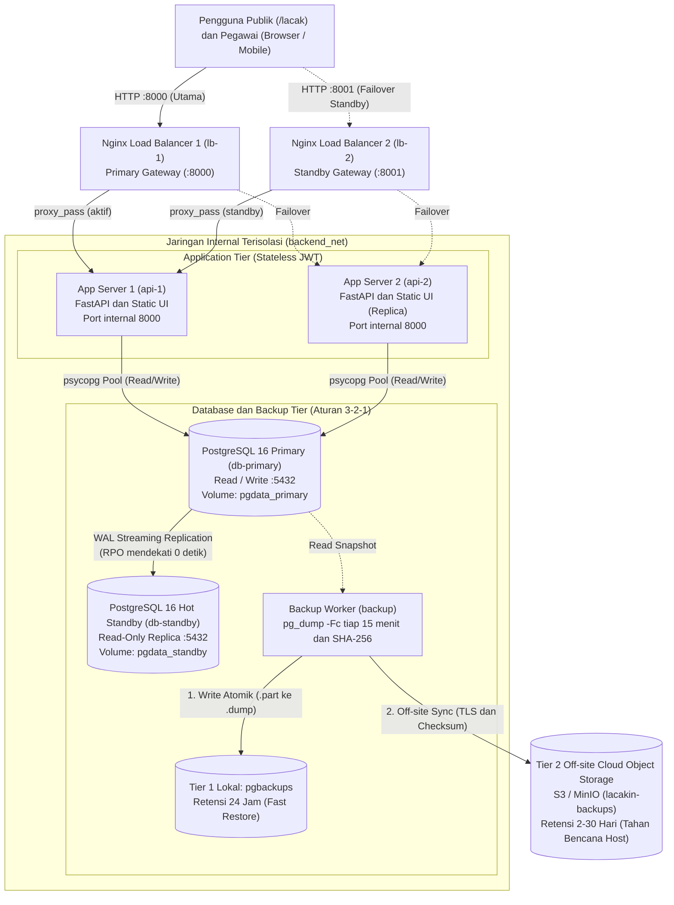
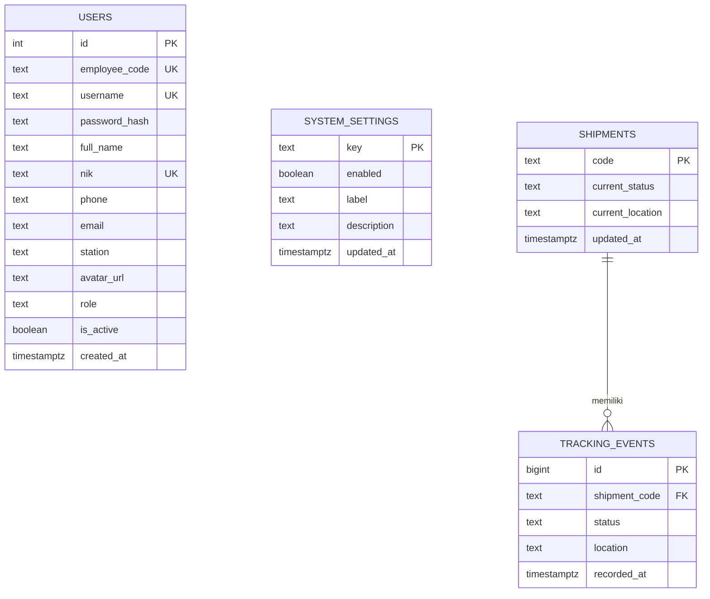

# Dokumen Spesifikasi Arsitektur dan Disaster Recovery Plan (DRP Awal) - Pertemuan 1

- **Mata Kuliah:** Cloud Computing
- **Kelompok:** 6
- **Aplikasi:** LacakIn (`logistik-dr`) — Sistem Monitoring Pengiriman dan Tracking Logistik
- **Target Lingkungan:** Localhost / Docker Desktop (High Availability and Disaster Recovery)
- **Versi Dokumen:** P1-1.0 (Baseline Perencanaan dan Setup Aplikasi)

---

## 1. Tim Pengembang dan Penanggung Jawab DRP
| Nama | NIM | Peran Proyek dan DRP |
| :--- | :--- | :--- |
| Ammar Arifin | 09040624081 | Lead Architect, Backend FastAPI, dan Koordinator DRP |
| Azzam Wildan Shidqii Al-afghani | 09040623054 | Database Architect (Primary/Standby) dan Backup Lead |
| Hassan Abdirahman Saman | 09060624104 | Frontend UI/UX LacakIn dan Integrasi API |
| Moch. Rafli | 0902062038 | Containerization, Nginx Load Balancer, dan Network Security |
| Muhammad Yusuf Multazam | 09020624053 | Quality Assurance, Load Testing, dan Dokumentasi Laporan |

---

## 2. Analisis Kebutuhan dan Studi Kasus
**LacakIn** (`logistik-dr`) adalah aplikasi manajemen resi dan pencatatan checkpoint pengiriman secara *real-time*. Sistem memisahkan akses pelanggan publik dari portal internal pegawai menggunakan **Role-Based Access Control (RBAC)** berbasis autentikasi **NIK atau NIP (Nomor Induk Pegawai)**, hashing **PBKDF2-HMAC-SHA256**, dan token **JWT HS256**.

### Pemisahan Akses Publik dan Role Pegawai (RBAC)
| Role | Kode Pegawai (NIP) | Akses Halaman | Hak Akses Aksi |
| :--- | :--- | :--- | :--- |
| `guest` (Publik) | - | `/lacak`, `/login`, `/register` | Melacak resi publik (termasuk Scan Resi via kamera) dan mengunduh bukti pengiriman tanpa akses menu internal |
| `kurir` | `KUR-XXXX` | `/`, `/checkpoint`, `/pengiriman`, `/lacak`, `/profil` | Melihat daftar paket tugas aktif, update checkpoint lapangan (`DALAM_PERJALANAN`, `DIKIRIM`, `SELESAI`) dengan wajib foto bukti (file/kamera), serta kelola profil dan foto akun sendiri |
| `operator` | `OPR-XXXX` | `/`, `/checkpoint`, `/pengiriman`, `/lacak`, `/profil` | Input paket baru, update seluruh status checkpoint dengan foto bukti, cetak laporan operasional (Harian/Mingguan/Bulanan ke Excel atau PDF), serta kelola profil sendiri |
| `supervisor` | `SPV-XXXX` | `/`, `/pengiriman`, `/lacak`, `/profil` | Memantau daftar pengiriman, filter status, melacak resi (*read-only*), cetak laporan operasional (Harian/Mingguan/Bulanan ke Excel atau PDF), serta kelola profil sendiri |
| `admin` | `ADM-XXXX` | `/`, `/pengiriman`, `/checkpoint`, `/lacak`, `/pegawai`, `/profil` | Akses penuh operasional, cetak laporan Excel/PDF, hapus resi dan lampiran bukti, serta aktif/nonaktif akun dan ubah jabatan pegawai operasional |
| `superadmin` | `SUP-XXXX` | Semua halaman termasuk `/pegawai`, `/backup`, `/profil` | Seluruh akses `admin` ditambah kontrol fitur sistem (`system_settings`) serta monitoring snapshot dan DR (`/backup`) |

---

## 3. Spesifikasi Arsitektur Aplikasi dan Target High Availability (HA / DR)

Pada Pertemuan 1, aplikasi LacakIn dirancang secara modular dan **stateless** agar siap dijalankan pada arsitektur *multi-tier* terisolasi dengan **2 Load Balancer (`lb-1`, `lb-2`)**, **2 Application Server (`api-1`, `api-2`)**, **2 Database Server (`db-primary`, `db-standby`)**, **1 Backup Scheduler (`backup`)**, dan **1 Off-site Cloud Object Storage (`cloud-s3`)**.

### A. Diagram Arsitektur Target dan Isolasi Jaringan

### B. Spesifikasi Teknis Tiap Komponen dan Rencana Hardening

| Service | Peran dan Fungsi | Jaringan dan Port | Volume Persisten | Healthcheck dan Restart |
| :--- | :--- | :--- | :--- | :--- |
| `lb-1` | Nginx `1.27-alpine` Load Balancer Utama (*load balancer* dan *failover router* ke `api-1`/`api-2`) | `frontend_net` (ekspos `8000:80`) dan `backend_net` | - | Probe HTTP `/health` tiap 10s, `restart: unless-stopped` |
| `lb-2` | Nginx `1.27-alpine` Load Balancer Standby (aktif melayani `:8001` jika `lb-1` mati di localhost) | `frontend_net` (ekspos `8001:80`) dan `backend_net` | - | Probe HTTP `/health` tiap 10s, `restart: unless-stopped` |
| `api-1` | App Server 1 (Python 3.12 + FastAPI + Uvicorn + Static UI LacakIn) | `backend_net` (internal `8000`, tanpa ekspos host) | `/backups` (read-only untuk `superadmin`) | `GET /health` cek koneksi DB (`SELECT 1`), non-root user, limit CPU/RAM |
| `api-2` | App Server 2 (Replica/Standby identik `api-1`, *stateless*) | `backend_net` (internal `8000`, tanpa ekspos host) | `/backups` (read-only untuk `superadmin`) | `GET /health`, aktif menggantikan `api-1` secara otomatis jika `api-1` down |
| `db-primary` | PostgreSQL 16 utama untuk transaksi tulis (`POST`, `DELETE`) dan baca (`GET`) | `backend_net` (internal `5432`, tanpa ekspos host) | `pgdata_primary` | `pg_isready -U logistik`, `wal_level=replica`, `max_wal_senders` |
| `db-standby` | PostgreSQL 16 replika *Hot Standby* via *WAL Streaming Replication* dari `db-primary` | `backend_net` (internal `5432`, tanpa ekspos host) | `pgdata_standby` | `pg_isready`, siap dipromosikan (`pg_ctl promote`) saat `db-primary` gagal |
| `backup` | Worker menjalankan `pg_dump -Fc -Z 6` tiap 900s, verifikasi SHA-256, simpan lokal, dan sync ke Cloud S3 | `backend_net` (internal) | `pgbackups` | Penulisan atomik `.part` ke `.dump`, `restart: unless-stopped` |
| `cloud-s3` | Off-site Cloud Object Storage (MinIO S3-Compatible di localhost / AWS S3 atau R2 di cloud) | `backend_net` / Endpoint HTTPS S3 | `s3data` / Bucket Cloud | Menyimpan salinan arsip harian **2-30 hari** sesuai Aturan 3-2-1 |

### C. Mekanisme Failover, Aturan Backup 3-2-1, dan Justifikasi Retensi
1. **Failover App Server (`api-1` ke `api-2`):** Nginx memantau status `api-1` dan `api-2` (`max_fails=2 fail_timeout=10s`, `proxy_next_upstream error timeout http_502 http_503`). Jika `api-1` mati mendadak, Nginx langsung meneruskan request ke `api-2` tanpa error di sisi pengguna dan tanpa memutuskan login karena sesi disimpan dalam **JWT HS256** (*stateless*).
2. **Failover Database vs Proteksi Human Error (`db-primary` + `db-standby` + Snapshot):**
   - `db-standby` melindungi dari kegagalan hardware/container (*WAL Streaming Replication*, RPO mendekati 0 detik).
   - Namun kesalahan logika atau *human error* (`DELETE` massal tanpa `WHERE`) di `db-primary` akan ikut tereplikasi ke `db-standby`, sehingga **snapshot berkala `pg_dump` + Cloud S3 tetap wajib** untuk pemulihan ke titik sebelum kesalahan terjadi.
3. **Aturan Backup 3-2-1 dan Retensi Bertingkat (*Tiered Retention*):**
   - **Mengapa interval 15 menit:** Mengunci **RPO <= 15 menit** sesuai target DRP tanpa membebani CPU/I/O disk seperti backup per menit.
   - **Tier 1 Lokal (`pgbackups`, Retensi 24 Jam):** Menyimpan maksimal 96 arsip terbaru untuk **fast recovery** pada hari berjalan tanpa membuat disk volume container penuh.
   - **Tier 2 Off-site Cloud S3 (`lacakin-backups`, Retensi 2–30 Hari):** Setiap arsip terkompresi divalidasi (`pg_restore --list` dan checksum **SHA-256**) lalu disinkronkan ke Cloud S3. Jika insiden baru terdeteksi **lebih dari 24 jam** atau seluruh disk host rusak total, data tetap dapat dipulihkan dari Cloud S3.
4. **Isolasi Keamanan (*Defense in Depth*):** Hanya container `lb` yang dapat diakses dari luar melalui port `8000`. Database, App Server, dan Worker Backup berada di jaringan internal tertutup, dan akses daftar backup (`/api/backups`) dibatasi khusus role `superadmin`.

### D. Justifikasi Pemilihan Teknologi dan Alasan Redundansi (2 LB, 2 API, 2 DB)

| Keputusan Desain | Alasan Teknis (Mengapa Dipilih) | Dampak Jika Tidak Dipakai (Single Point of Failure) |
| :--- | :--- | :--- |
| **Backend: FastAPI + Uvicorn (Python 3.12)** | Mendukung I/O non-blocking (ASGI), validasi input ketat via **Pydantic** (mencegah data korup masuk ke DB), dokumentasi OpenAPI otomatis (`/docs`), serta jauh lebih ringan dan cepat dibanding Django/Flask sinkron saat diuji beban tinggi (`k6`). | Validasi manual rawan bug, throughput rendah pada concurrency tinggi, dan butuh boilerplate lebih banyak. |
| **Database: PostgreSQL 16 (bukan SQLite/MySQL/NoSQL)** | Sistem tracking logistik bersifat **transaksional relasional (ACID)** (`shipments` -> `tracking_events` dengan *Foreign Key* dan `CHECK` constraint). PostgreSQL 16 memiliki fitur bawaan **WAL Streaming Replication** dan backup konsisten (`pg_dump -Fc` + `pg_restore --list`) tanpa mengunci tabel operasional. | SQLite tidak mendukung multi-container write; NoSQL kurang cocok untuk integritas referensial resi-event yang ketat. |
| **Load Balancer: Nginx `1.27-alpine`** | Ringan (~15 MB RAM), mampu menangani ribuan koneksi konkuren (*event-driven*), mendukung *health-based failover* (`max_fails`, `proxy_next_upstream`), dan DNS dinamis Docker (`resolver 127.0.0.11`). | Ekspos API langsung ke publik membuka celah keamanan dan tidak bisa melakukan *automatic failover* antar container API. |
| **2 Load Balancer (`lb-1` + `lb-2`)** | Menghilangkan *Single Point of Failure* pada layer gateway. Jika `lb-1` (`:8000`) mati atau sedang di-restart, trafik tetap dapat dilayani melalui `lb-2` (`:8001`) yang terhubung ke cluster API yang sama (simulasi *Active-Standby Gateway* di lingkungan single-host; di cloud ditempatkan di belakang DNS/Floating IP). | Jika hanya 1 LB dan container LB mati, seluruh aplikasi lumpuh total walaupun `api-1`, `api-2`, dan DB masih sehat. |
| **2 App Server (`api-1` + `api-2`, Stateless)** | Membagi beban trafik (*round-robin*) dan menjamin *Zero-Downtime App Failover*. Karena autentikasi memakai **JWT stateless** (tanpa session di memori container), matinya `api-1` tidak membuat pegawai ter-logout saat dialihkan ke `api-2`. | Jika hanya 1 API, proses restart/crash atau bottleneck CPU membuat seluruh sistem tidak bisa diakses (`502 Bad Gateway`). |
| **2 Database (`db-primary` + `db-standby`)** | `db-primary` menangani transaksi tulis (`read-write`), sementara `db-standby` menerima replikasi WAL secara *real-time* (`RPO` mendekati 0 detik) dan menjadi target failover jika `db-primary` rusak. | Jika hanya 1 DB tanpa replikasi, kerusakan container/volume DB langsung menghentikan seluruh operasi dan berisiko kehilangan data transaksi terakhir. |
| **Container `backup` Terpisah (+ Cloud S3 di P5)** | Menjaga prinsip *separation of concerns*: proses kompresi `pg_dump` dan verifikasi `pg_restore --list` + `SHA-256` tidak membebani container DB/API, sekaligus melindungi dari *human error* (`DELETE` massal yang ikut tereplikasi ke standby). | Tanpa snapshot terisolasi, kesalahan `DELETE`/`DROP` pada primary akan langsung menghapus data di standby juga. |

---

## 4. Desain Basis Data (ERD)

### Detail Skema (`db/init.sql`)
- `users`: profil pegawai lengkap dengan `nik` (unik 16 digit), `employee_code` (NIP unik otomatis per jabatan: `KUR-XXXX`, `OPR-XXXX`, `SPV-XXXX`, `ADM-XXXX`, `SUP-XXXX`), password hash `pbkdf2_sha256`, serta flag `is_active` untuk kontrol akses.
- `system_settings`: konfigurasi toggle fitur operasional (`public_tracking`, `self_register`, `checkpoint_write`).
- `shipments`: status dan posisi terakhir paket (`code` PK, `current_status`, `current_location`, `updated_at`).
- `tracking_events`: histori pergerakan paket berindeks waktu (`id` PK, `shipment_code` FK, `status`, `location`, `recorded_at`).

---

## 5. Spesifikasi Endpoint API

| Method | Endpoint | Akses | Deskripsi |
| :--- | :--- | :--- | :--- |
| `GET` | `/health` | Publik / LB | Liveness dan readiness probe (verifikasi koneksi database `SELECT 1`) |
| `POST` | `/api/auth/login` | Publik | Login pegawai memakai NIK, NIP, atau Username dengan deteksi error spesifik (identitas tidak ditemukan, kata sandi salah, atau keduanya salah) dan penerbitan JWT Bearer token |
| `POST` | `/api/auth/register` | Publik | Registrasi pegawai lengkap (`kurir`, `operator`, `supervisor`) dengan auto-generate NIP |
| `GET` / `PATCH` | `/api/auth/me` | Login (Semua Role) | Membaca dan memperbarui informasi akun milik sendiri (nama, username, kontak, lokasi, kata sandi, serta upload/kamera/hapus foto profil `avatar_url`) |
| `POST` / `GET` / `DELETE` | `/api/uploads`, `/api/uploads/{key}` | Operasional / Publik | Upload foto bukti pengiriman ke storage CDN (`cdn_uploads`), daftar lampiran bukti (terfilter dari file `avatar_`), dan hapus bukti (`admin`/`superadmin`) |
| `GET` | `/api/dashboard` | Publik | KPI agregat, distribusi status, dan 10 aktivitas terbaru |
| `GET` | `/api/shipments` | Publik | Daftar pengiriman beserta jumlah event |
| `GET` | `/api/shipments/{code}/events` | Publik | Riwayat perjalanan (`tracking_events`) untuk satu nomor resi |
| `POST` | `/api/events` | Publik / Operasional | Mencatat event checkpoint (`kurir` dibatasi status pengiriman, `supervisor` ditolak 403) |
| `DELETE` | `/api/shipments/{code}` | `admin`, `superadmin` | Menghapus pengiriman dan event terkait (`401`/`403` jika tidak berhak) |
| `GET` / `PATCH` | `/api/users`, `/api/users/{id}` | `admin`, `superadmin` | Melihat daftar pegawai, mengaktifkan/menonaktifkan akun, dan mengubah jabatan/penempatan |
| `GET` / `PATCH` | `/api/settings`, `/api/settings/{key}` | `superadmin` | Melihat dan mengaktifkan/menonaktifkan fitur sistem (`public_tracking`, `self_register`, `checkpoint_write`) |
| `GET` | `/api/backups` | `superadmin` | Mengambil daftar arsip `.dump` dari volume `/backups` (`401`/`403` jika tidak berhak) |

---

## 6. Disaster Recovery Plan (DRP Awal - Baseline P1)

Mengacu pada dokumen target Kelompok 6 (`DRP_Kelompok_6.pdf` v1.1):

### A. Business Impact Analysis (BIA) dan Sasaran Pemulihan
- **Proses Kritis:** Pelacakan resi pelanggan (`/lacak`) dan pencatatan checkpoint armada/gudang (`POST /api/events`).
- **RTO (Recovery Time Objective):** maksimal **15 menit** (target failover node API di bawah 5 detik, pemulihan database kurang dari 2 menit).
- **RPO (Recovery Point Objective):** maksimal **15 menit** untuk pemulihan berbasis snapshot `pg_dump`, dan mendekati **0 detik** pada skema replikasi `db-primary` ke `db-standby`.

### B. Matriks Skenario Bencana dan Rencana Mitigasi (D1–D7)
| Kode | Skenario Bencana | Dampak | Strategi Pemulihan Target |
| :--- | :--- | :--- | :--- |
| **D1** | Container `api-1` mati / crash | Request tidak terlayani jika single-node | Nginx `lb` otomatis mengalihkan trafik ke `api-2` (App Server 2) tanpa putus sesi JWT |
| **D2** | Container `db-primary` mati | Layanan baca/tulis database gagal (`/health` 503) | Restart otomatis container DB atau promosi `db-standby` menjadi primary |
| **D3** | Volume database utama hilang/korup | Data pengiriman dan akun pegawai hilang | Rekreasi volume lalu restore dari `db-standby` atau snapshot `.dump` terbaru via `pg_restore` |
| **D4** | Kesalahan manusia (hapus data massal) | Data pengiriman penting terhapus permanen | Isolasi tulis sementara dan *rollback* ke `.dump` sebelum insiden (Tier 1 `< 24 jam` atau Cloud S3 `> 24 jam`) |
| **D5** | Worker `backup` berhenti | Tidak ada snapshot baru (RPO terancam) | Restart service `backup`, cek log container, dan verifikasi terbentuknya file `.dump` + sync Cloud S3 |
| **D6** | Load Balancer 1 (`lb-1`) mati / config rusak | Akses `:8000` terputus meski `api` dan `db` hidup | Alihkan trafik uji ke **`lb-2` (`:8001`)** sementara `lb-1` diperbaiki/restart (`nginx -t`); di cloud produksi memakai **Keepalived Virtual IP** atau **Managed Load Balancer** |
| **D7** | Host / disk lokal rusak total | Seluruh container, `pgdata`, dan `pgbackups` lokal hilang bersamaan | **Cold Rebuild** stack di host baru (`git clone` lalu `docker compose up -d`) dan `pg_restore` dari salinan **Off-site Cloud Object Storage (S3/R2)** |

> **Catatan Keterbatasan Lingkungan Lokal (`localhost`):** Pada satu laptop/host Docker Desktop, dua container Nginx tidak dapat mengikat port `8000` yang sama secara bersamaan tanpa *Virtual IP* antar dua mesin fisik atau *Managed LB* di cloud. Karena itu, di lokal `lb` dijalankan dengan `restart: unless-stopped` (atau `lb-2` standby di port `:8001`), sedangkan di lingkungan produksi cloud wajib menggunakan *Active-Passive LB (Keepalived/VRRP)* atau *Cloud Load Balancer*.

---

## 7. Checklist Kelengkapan Pertemuan 1
- [x] Pembagian peran tim dan penanggung jawab DRP
- [x] Desain database ERD 3 tabel (`users`, `shipments`, `tracking_events`) di `db/init.sql`
- [x] Implementasi aplikasi LacakIn dengan pemisahan halaman publik (`/lacak`) dan portal pegawai (`/login`, `/register`, `/`, `/checkpoint`, `/pengiriman`, `/backup`)
- [x] Autentikasi berbasis NIK/NIP, hash PBKDF2-HMAC-SHA256, JWT HS256, dan RBAC 5 peran
- [x] Blueprint arsitektur target 2 App Server (`api-1`, `api-2`), 2 Database (`db-primary`, `db-standby`), dan Tier 2 Cloud S3 (3-2-1 Rule) siap diimplementasikan pada Pertemuan 2
- [x] Dokumen DRP Awal (RTO, RPO, BIA, dan matriks skenario lengkap D1–D7)

---

## 8. Lampiran Prompt AI (Pertemuan 1)

1. *"Susun arsitektur aplikasi LacakIn (logistik-dr) dengan FastAPI, PostgreSQL 16, Nginx load balancer, dan worker backup pg_dump 15 menit yang siap dikembangkan menjadi topologi 2 App Server dan PostgreSQL Primary-Standby dengan target RTO <= 15 menit dan RPO <= 15 menit."*
2. *"Tambahkan autentikasi berbasis NIK atau NIP menggunakan PBKDF2-HMAC-SHA256 dan JWT HS256 serta RBAC 5 peran (kurir, operator, supervisor, admin, superadmin) dengan registrasi pegawai lengkap dan auto-generate NIP per peran."*
3. *"Pisahkan halaman lacak resi publik dari portal pegawai, sediakan halaman login dan register terpisah dengan fitur show/hide password, konfirmasi logout, serta logo vektor SVG yang responsif di desktop dan mobile."*
